# AgentWatch model development submission

Status as of 2026-11-15 (evening), `main` at `39b98ad`. This report maps the course's *Model Development Guidelines* to this
repository's evidence. It adds no new results: every number comes from the linked document, except the two items marked as observed
for this submission (the macOS reproduction in section 12 and the local MLflow screenshots in the figures section). Work
that is merged on `main` is separated from work still in review and from work not done.

**Verdict.** The model is a research candidate, not a production model. It beats the rule baseline
on the frozen test split, but it fails its own bias check on contended steps, four
contract gates are `not_evaluated`, and it blocks promotion.

| Marker | Meaning |
|---|---|
| **Merged** | On `main` |
| **In review** | Open pull request, not yet on `main` |
| **Not done** | No code or evidence yet |

## 1. Problem and targets

AgentWatch attributes excess waiting in an agent step to a resource. One row is one measured step.

- Classification target `label_resource`: `none`, `cpu_sandbox`, `inference`, `retrieval`.
  Steps labeled `mixed` are scored by `mixed-scoring-v1`.
- Regression target `label_excess_fraction`.
- Contract and gates, declared before any model was evaluated: [evaluation contract](evaluation-contract.md).

## 2. Data pipeline and splits (**Merged**)

- Release `steps-v1.3+aafae73eb211`: 5,953 rows, versioned with DVC, public download. See the [data card](data-card.md).
- Split `split-v3+932b2df410a7` (`eval-contract-v3`): train 1,755 steps, validation 273, test 3,575
  (`fix-window-count`, a task absent from training). See [ADR 0012](adr/0012-split-v3-held-out-a06-evidence-and-validation.md).
- The A06 natural-overload evidence is held out and never used for training, calibration or tuning.
- Leakage, class balance, independence and mixed-in-test checks pass; the held-out-method check is `not_met`.

## 3. Models and selection (**Merged**)

LightGBM classifier and regressor, trained on the frozen split, compared with the transparent
`rules-v1` baseline on identical test rows. Details: [model training](model-training.md).

| Measure (3,564 scored test steps) | Rules | `training-v1` | `training-v2` (tuned) | `training-v3` (selected) |
|---|---|---|---|---|
| Macro F1 | 0.200 | 0.790 | 0.787 | 0.790 |
| Clean steps predicted `none` (gate 0.95) | 0.731 | 0.991 | 0.989 | 0.988 |
| Excess-latency MAE (limit 0.10) | | 0.076 | 0.077 | 0.076 |

- **Selected model:** `training-v3`, which is `training-v2`'s settings with condition-balancing weights. It was
  adopted on validation by the declared bias-mitigation rule (section 8), not on test. The three settings are level on
  test within what one test task can separate ([model bias](model-bias.md)).
- Gates: after M03 (training), 5 pass and 6 are `not_evaluated`. M04 (calibration) then evaluates calibration and
  abstention, and both pass (section 6), which leaves 4 `not_evaluated`: unseen tasks, held-out injection method,
  live attribution latency and instrumentation overhead. Those four are why the model blocks promotion.
- The model is far above the rule baseline, which cannot predict `inference` or `retrieval` by construction.
- Mixed contention: macro F1 0.534 against 0.047 for the rules on 82 steps (gate gain 0.10: pass).

## 4. Hyperparameter tuning (**Merged**, PR #81)

Declared before any run (`tuning-v1+f729092b`): a 162-point grid over `learning_rate`, `num_leaves`,
`min_data_in_leaf`, `lambda_l2` and `feature_fraction`. Selection reads validation only (log loss for the
classifier, MAE for the regressor). Every grid point is a nested MLflow run. None failed.

- Validation: classifier log loss 0.1579 to 0.1462 (7.4%), regressor MAE 0.0524 to 0.0476 (9.3%).
- **The gain did not carry over to test**: `training-v2` is slightly worse than `training-v1` on every test measure.
  The result is reported, not used to switch back, because choosing on test would be tuning on it. The selected
  model is `training-v3`, which builds on `training-v2` (section 3).

## 5. Experiment tracking (**Merged**)

MLflow (local SQLite) logs settings, metrics, model versions and artifacts for training, tuning, calibration, bias
and registry runs. The stores are local to the machine that ran them and are not committed. Re-running reproduces the model files byte for byte on Linux.

## 6. Validation, calibration and abstention (**Merged**)

Temperature scaling and an abstention threshold are fitted on validation only. M04 evaluates the calibration and
abstention gates, and both pass. Calibration made test ECE slightly worse, not better, so raw scores are not
confidence. Details: [model calibration](model-calibration.md).

| Model | Temperature | Test ECE, calibrated (uncalibrated) | Abstention |
|---|---|---|---|
| `training-v1` | 0.897 | 0.0178 (0.0074) | 2.4% of steps |
| `training-v3` (selected) | 0.797 | 0.020 (0.009) | none |

## 7. Result figures and sensitivity analysis (**Merged**, PR #82)

`make model-analysis`: confusion matrices (model and rules), model comparison, exact TreeSHAP importance and a
hyperparameter-sensitivity plot. Hyperparameter sensitivity (median validation log loss) from the merged tuning
report: `lambda_l2` and `num_leaves` matter most; `learning_rate`, `min_data_in_leaf` and `feature_fraction` move
it by under 0.003; no setting moves the regressor's MAE by more than 0.0014.

## 8. Bias detection by slices (**Merged**, PR #83)

The dataset has no demographic attributes, so the slices are the conditions a model could serve unevenly:
run condition, telemetry readings complete or missing, and single-class or mixed contention. Thresholds were
declared before the check ran (`bias-v1`): a slice is flagged when its correct rate is more than 0.10 below the
overall rate, and slices under 30 steps are reported as insufficient. See [model bias](model-bias.md).

| Test slice | Correct rate |
|---|---|
| Overall | 0.943 |
| Condition: baseline / clean | 0.992 / 0.989 |
| Condition: contended | 0.835 (**flagged**) |
| Single-class contention | 0.732 (**flagged**) |
| Mixed contention | 1.000 (82 steps) |

- Mitigation: condition-balancing weights (`training-v3`), adopted on validation (worst disparity 0.118 to 0.092).
- **Honest result: inconclusive.** The flagged validation slice has 34 steps; on test the weighting changes little
  (single-class contention 0.732 to 0.741). The check still fails on test.
- Cause: most misses are `cpu_sandbox` and `retrieval` steps predicted `none`. More contended runs per class are
  needed, not reweighting.

## 9. Docker, registry and rollback (**Merged**, PR #84)

One image runs the whole pipeline (pull data, verify the split hash, train, calibrate, bias check, analysis,
register). `make register-model` pushes to a model registry with `candidate` and `champion` aliases. `champion`
moves only for an eligible model that is not worse than the current champion; `make rollback-model` restores the
previous one. A run on 2026-11-15 reproduced the local model byte for byte. MLflow's registry is local; the GCP push is in
section 10. See [model pipeline](model-pipeline.md).

### Rollback and deployment scope

- **Rollback rule.** `champion` moves to a new version only when the model is eligible, was scored on the same split
  and dataset as the current champion, and its test macro F1 is not lower (`max_macro_f1_drop = 0` in
  `registry.toml`). Otherwise the champion is kept, which is the automatic rollback. `make rollback-model` points
  `champion` back at the version it replaced. The tests in `test_register_model.py` cover a worse model being kept
  out, a promotion-blocked model never becoming champion, and `test_rollback_through_main`.
- **Not exercised on a real model.** No model has been eligible, so `champion` has never been set; the recorded
  evidence is the rejected path. Across CI runs the comparison is not applied, because MLflow's database does not
  outlive a job (see section 10).
- **Deployment is out of scope.** The guidelines ask the pipeline to deploy only "if your project includes a
  deployment". This project has no serving code: Milestone 7 (deployment) is open in `docs/project-checklist.md`.
  The [serving contract](model-serving-contract.md) says what a server must reproduce and that a model with
  `blocks_promotion: true` must not be served as promoted.

## 10. CI/CD, notifications and GCP registry (**Merged**, PR #86)

`.github/workflows/model.yaml` runs the model image on every pull request and push to `main` that touches model,
data or versioning code, and on demand. It trains, validates, bias-checks, keeps the figures and reports as a
workflow artifact for 30 days, pushes to GCP Artifact Registry from `main`, and alerts Slack. Setup and rules are in
[model CI](model-ci.md).

- **Registry rule:** every evaluated model goes to `attribution-candidate`. Only an eligible model (no failed gate,
  no failed bias check on test, not blocking promotion) goes to `attribution-champion`. Today none is eligible, so
  the champion package stays empty and Slack reports why.
- **Configured 2026-11-15:** the repository holds the five GCP variables (project, location, repository, service
  account, workload identity provider) and the Slack webhook secret. Authentication uses workload identity
  federation, so no key file exists.
- **Shown working, 2026-11-16 01:41 UTC:** the first run on `main` with these settings
  (`github.com/all3n2601/AgentWatch/actions/runs/43787735612`) succeeded end to end. It built the image, ran the
  pipeline, authenticated to Google Cloud, uploaded 7 files (classifier, regressor, preprocessing, calibration,
  reports and `registration.json`) as version `m-197ffd968d86` of `attribution-candidate` in project
  `agentwatch-512815` (`us-central1`, repository `agentwatch-models`), and sent the Slack alert. The registered
  model was not eligible (`eligible: false`), so nothing went to `attribution-champion`. Add the Slack message and
  the Artifact Registry console as screenshots; they are not in the repository.
- Earlier pull-request runs of the workflow include one failure and one cancellation on 2026-11-15 before the
  passing run. Pull requests skip the push and the alert by design.
- **Rollback caveat:** MLflow's database does not outlive a CI run, so the "keep the champion unless the new model is at
  least as good" comparison is not applied across CI runs. Rolling back means serving an earlier registry version. A
  persisted champion pointer is an open item.
- PR #87 (merged 2026-11-16) fixed the saved model files' permissions so other users can read them.

### Passing-model path

No recorded model is eligible today, so the promotion path for a passing model is covered by tests, not by a
recorded run: `test_register_model.py` (`test_the_first_eligible_version_becomes_candidate_and_champion`,
`test_a_worse_model_is_registered_but_the_champion_is_kept`, `test_a_model_that_blocks_promotion_never_becomes_champion`,
`test_rollback_through_main`) and `test_ci_report.py` (`test_eligible_model_goes_to_both_packages`,
`test_ineligible_model_goes_only_to_the_candidate_package`). The Slack alert and the empty champion package are the
recorded evidence for the rejected path.

## Figures and screenshots

The figures come from the `model-pipeline-43787735612` workflow artifact (kept 30 days, to about 2026-12-15) and the
registry and Slack screenshots from the live consoles on 2026-11-15. The MLflow screenshots are **observed for this
submission**: they come from a local run of the same image (`make model-pipeline-run`, 2026-11-15, 20:57), not from
the CI run, because CI's MLflow database does not outlive the job. The images are in
[`images/model-submission/`](images/model-submission/).

### Confusion matrices

`cpu_sandbox` recall is 35% (76 of 127 predicted `none`); `inference` is 97% and `retrieval` 72%. The rule baseline
never predicts `inference` or `retrieval`.

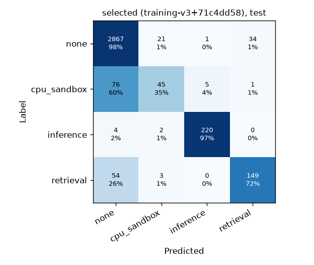

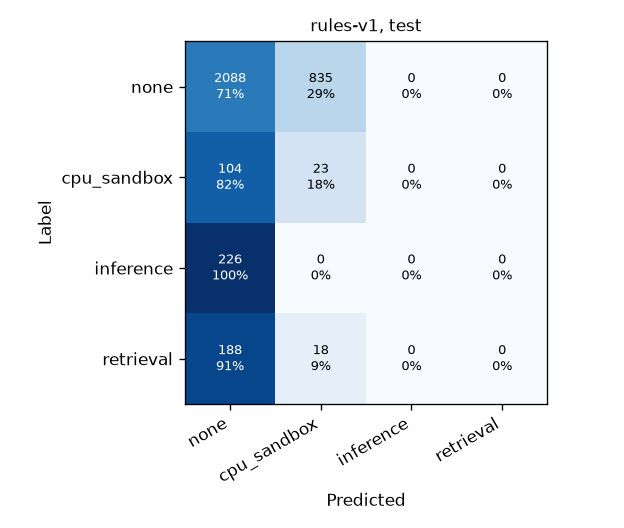

### Model comparison

Macro F1 0.790 against 0.200 for `rules-v1`; clean steps predicted `none` 0.988 against 0.731.

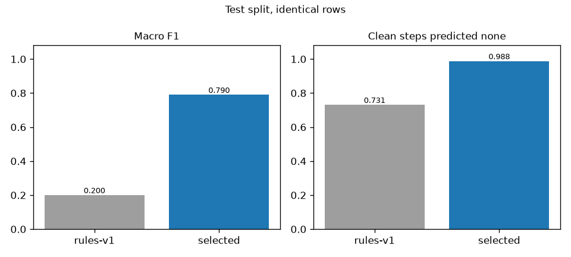

### SHAP feature importance

`duration_seconds`, `execution_seconds`, `queue_seconds` and `queue_fraction` dominate; the workload size features
carry about zero.

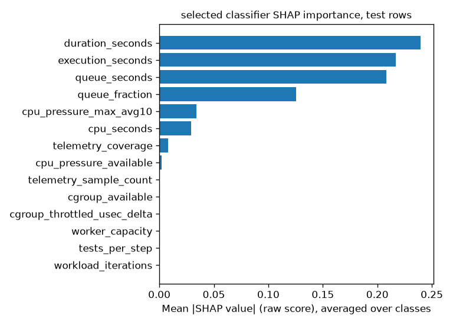

### Bias slices

The `contended` and `single_class` slices fall below the overall rate minus 0.1 on test (section 8).

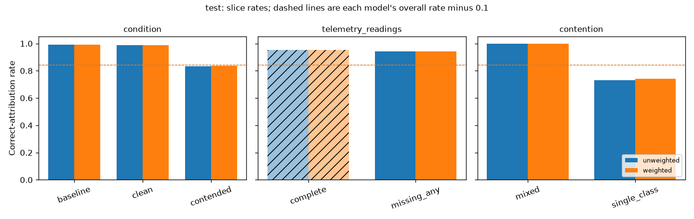

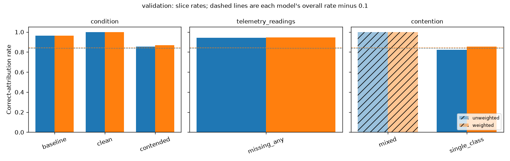

### Registry and alert

Version `m-197ffd968d86` in `attribution-candidate`, and the Slack alert for the same run: "model is not eligible"
because the bias check fails on test and the model blocks promotion.

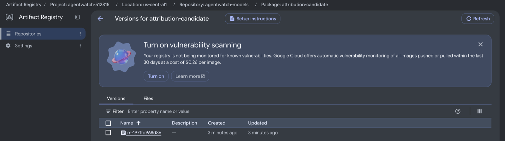

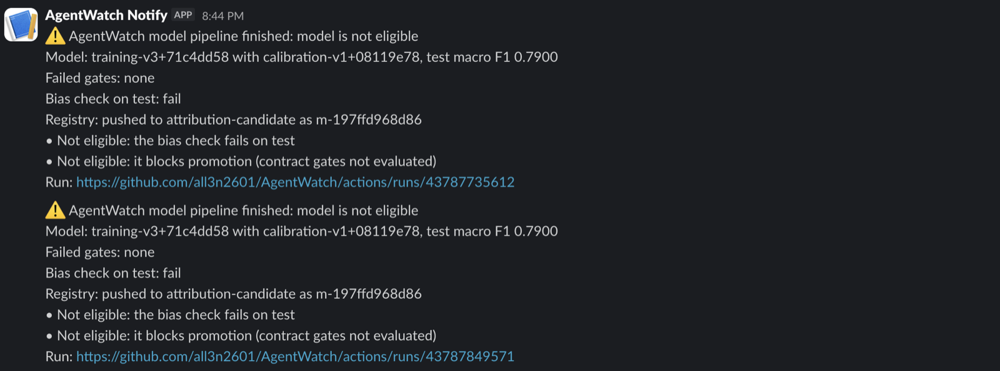

### MLflow (local run of the pipeline image)

Registered model `agentwatch-attribution` version 1 with alias `candidate`, its tags and `eligible: false`; the
experiments `agentwatch-attribution`, `-bias` and `-registry`; and the training run's metrics (macro F1 0.790).

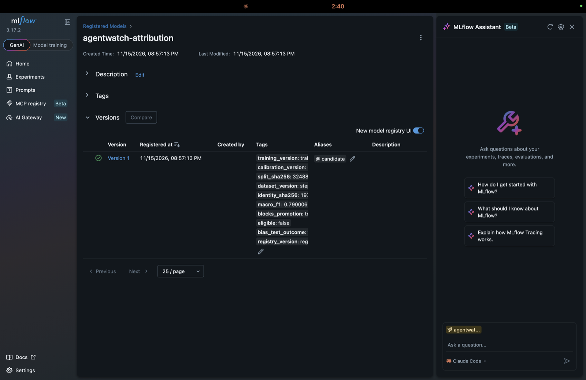

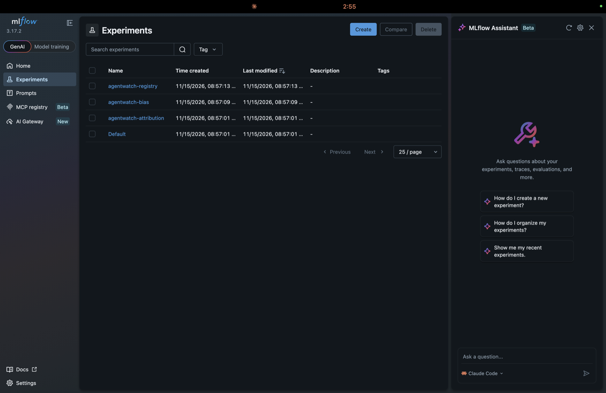

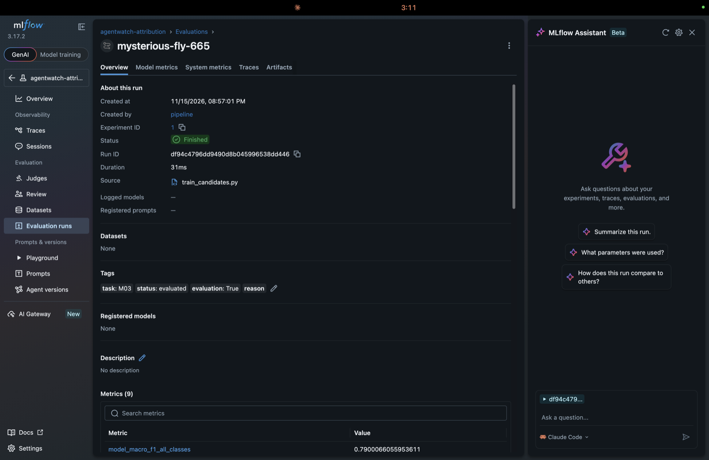

The hyperparameter-sensitivity figure (`sensitivity.png`) is not in the CI artifact because CI does not rerun
tuning. The tuning sensitivity numbers in section 7 come from the merged tuning report. The JSON records behind the
figures (`registration.json`, `bias/report.json`, `analysis.json`) are in the same workflow artifact.

## 11. Limitations

- One test task and one training task: generalization to unseen tasks is untested (gate `not_evaluated`).
- Contention is injected in a controlled setting; uncontrolled real contention is untested.
- `cpu_sandbox` recall is weak (45 of 127 test steps) and the bias check fails on contended steps.
- Calibration does not improve ECE; the held-out injection-method gate cannot run until such rows exist.
- Validation is 273 steps from 3 experiments, so tuning and mitigation decisions are noisy.
- Promotion stays blocked. New replay evidence (more tasks, graded `cpu_sandbox` intensity, mixed pairings) is
  requested but would need a new release, `split-v4` and a new contract version; results would not be comparable
  to the numbers above without retraining.

## 12. Reproduction

```sh
make pull-dataset TARGET=data/datasets
uv run --package agentwatch-data python -m agentwatch_data.splits --release data/datasets/steps-v1.3+aafae73eb211
make train-candidates SPLIT=data/datasets/splits/steps-v1.3+aafae73eb211/split-v3+932b2df410a7.json
make calibrate SPLIT=data/datasets/splits/steps-v1.3+aafae73eb211/split-v3+932b2df410a7.json
```

**Observed for this submission, not recorded in any linked document.** On 2026-11-15 a clean clone of `386d494` reproduced `classifier.txt`, `regressor.txt` and `preprocessing.json`
byte for byte on macOS. `report.json`, `predictions.jsonl` and `validation_predictions.jsonl` differed from the
recorded Linux hashes; the cause was not investigated. Training took about 13 seconds.

## 13. Evidence index

| Requirement | Evidence | Status |
|---|---|---|
| Load versioned data | [data card](data-card.md), `make pull-dataset` | Merged |
| Train, select best model | [model training](model-training.md) | Merged |
| Validation metrics | `report.json`, gates | Merged |
| Tuning, sensitivity | Section 4 and 7 | Merged |
| Experiment tracking | MLflow, section 5 | Merged |
| Bias slices and mitigation | [model bias](model-bias.md), section 8 | Merged |
| Figures, SHAP | `make model-analysis`, section 7 | Merged |
| Docker | `pipelines/model/Dockerfile`, section 9 | Merged |
| Registry push, rollback | `make register-model`, `make rollback-model`, [model CI](model-ci.md) | Merged; GCP push done (`m-197ffd968d86`); CI rollback limited |
| CI/CD, notifications | `.github/workflows/model.yaml`, run 43787735612, section 10 | Merged; run succeeded |
